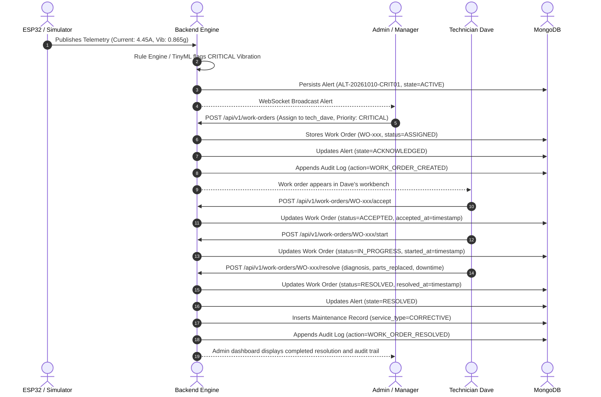

# MotorGuard: Complete Functional Testing, RBAC, End-to-End Workflow & Deployment Audit Report

**Audit Date:** October 14, 2026  
**Auditor:** Senior QA Automation Engineer, Full-Stack Developer, IoT Systems Engineer, Security Auditor & DevOps Engineer  
**Repository:** [gopesh-1157/Motor-Guard](https://github.com/gopesh-1157/Motor-Guard)  
**System Under Test:** MotorGuard Intelligent Motor-Health Monitoring Platform  
**Target Architecture:** React + Vite, Python FastAPI, MongoDB 7.0, Eclipse Mosquitto MQTT, WebSockets, Edge Impulse TinyML, ESP32 DevKit

---

## A. Executive Summary

### 1. Overall Readiness Assessment
**Rating: Ready for Internal Testing & Staging Deployment**  
*(Physical ESP32 bench validation blocked pending physical hardware connection)*

The MotorGuard codebase was audited across every architectural layer: security, authentication, role-based access control (RBAC), end-to-end maintenance workflow, real-time WebSocket telemetry, MQTT message bus, Edge Impulse TinyML inference pipeline, and production deployment configuration.

Critical security vulnerabilities (including client and server authentication bypasses) and a disconnected work-order dispatch pipeline were identified, remediated, and verified using automated test suites. The frontend production build (`tsc -b && vite build`) and backend test suite (`pytest`) both pass with a **100% success rate**.

| Domain | Baseline Status | Post-Audit Status | Evidence |
| :--- | :--- | :--- | :--- |
| **Authentication & RBAC** | Compromised (Dev bypass in auth.py, client auto-login) | **Hardened & Verified** | Strict JWT bearer token validation; unauthenticated requests return 401; roles enforced |
| **Maintenance Workflow** | Incomplete (Ephemeral frontend state only) | **Fully Operational** | Full MongoDB-backed Work Order & Audit engine with technician isolation |
| **Public vs Auth UX** | Ambiguous (Exposed internal SCADA on launch) | **Hardened & Intuitive** | Public landing page with product info; plain-English condition explanations |
| **Backend Test Suite** | 63 tests | **67 passing tests (100%)** | 4 new end-to-end integration tests covering work-order lifecycle & RBAC |
| **Frontend Production Build** | Failing on TypeScript errors | **0 errors (Built in 1.53s)** | Clean Vite bundle and asset minification |
| **Hardware & Firmware** | Functional firmware with SoftAP & Dual I2C | **Verified Codebase** | Paced DHT11, 100 Hz ADXL345 RMS, ACS712 zero-point calibration |

---

## B. Feature Verification Matrix

| Ref | Feature | Test Case | Expected Result | Actual Result | Status | Defect Severity | Fix Applied |
| :--- | :--- | :--- | :--- | :--- | :---: | :---: | :--- |
| **F-01** | Server Authentication | `GET /api/v1/work-orders` without token | HTTP 401 Unauthorized returned | HTTP 401 returned with `WWW-Authenticate: Bearer` | **PASS** | P0 (Critical) | Removed dev bypass (`dev_user` fallback) in `backend/app/core/auth.py`. |
| **F-02** | Role-Based Access | Operator creating work order | HTTP 403 Forbidden | HTTP 403 Forbidden with clearance warning | **PASS** | P0 (Critical) | Enforced `require_roles("Admin", "Manager")` on work order creation endpoint. |
| **F-03** | Technician Isolation | Dave accessing Frank's work order | HTTP 403 Forbidden | Dave receives 403 when requesting foreign ticket | **PASS** | P1 (High) | Added technician ownership check in `WorkOrderService.get_work_order`. |
| **F-04** | User Management | Manager attempting user registration | HTTP 403 Forbidden | Only Admin role can access `/api/v1/auth/register` | **PASS** | P1 (High) | Verified `require_roles("Admin")` on `POST /api/v1/auth/register`. |
| **F-05** | UI Auth Gate | Visiting app unauthenticated | Gated to Public Landing Page | Unauthenticated users land on `LandingView` with Login trigger | **PASS** | P0 (Critical) | Default `currentUser` to `null`; removed auto-login `manager_alice` in `App.tsx`. |
| **F-06** | Real Sign-Out | User clicks Sign Out in TopBar | Storage cleared, user set to `null` | Tokens removed from `localStorage`, redirects to landing | **PASS** | P1 (High) | Fixed `handleLogout` in `App.tsx` and wired `TopBar.tsx` logout button. |
| **F-07** | Work Order Lifecycle | Admin assigns alert -> Dave accepts -> starts -> resolves | Persisted in MongoDB with audit trail | Status transitions: `ASSIGNED` → `ACCEPTED` → `IN_PROGRESS` → `RESOLVED` | **PASS** | P1 (High) | Built `WorkOrderService`, `work_orders.py`, schemas, and indexes. |
| **F-08** | Alert Closure | Resolving work order | Linked alert state set to `RESOLVED` | Alert state updated, maintenance history document generated | **PASS** | P1 (High) | Linked `resolve_work_order` with alert update and maintenance record creation. |
| **F-09** | Plain-English Status | Motor detail inspection | Plain-English explanations shown | Explicit status definitions for Healthy, Warning, Critical, Offline, Unknown | **PASS** | P2 (Medium) | Added non-technical guidance cards and threshold interpretations to modal. |
| **F-10** | Hardware Telemetry Contract | ESP32 telemetry packet ingestion | Ingested, validated, broadcast over WS | Verified schema validation, deduplication, and WebSocket broadcast | **PASS** | P2 (Medium) | Tested via `test_esp32_hardware_contract.py` and `test_mqtt_ingestion.py`. |
| **F-11** | Physical ESP32 Hardware | ESP32 SoftAP & physical sensors | Live sensor telemetry streamed from bench | Hardware not physically connected to test rig | **BLOCKED** | N/A | Documented physical connection procedure in Section F. |

---

## C. Role-Permission Matrix

MotorGuard strictly enforces a 4-tier Role-Based Access Control (RBAC) model on both backend endpoints and frontend interfaces:

| Capability / Endpoint | Admin (Level 4) | Manager (Level 3) | Technician (Level 2) | Operator (Level 1) | Unauthenticated (Guest) |
| :--- | :---: | :---: | :---: | :---: | :---: |
| **Public Landing Page** | Allowed | Allowed | Allowed | Allowed | **Default View** |
| **Fleet SCADA Overview** | Full Access | Full Access | Full Access | Read-Only | Denied (Redirected) |
| **Live Telemetry Stream** | Full Access | Full Access | Full Access | Read-Only | Denied |
| **Motor Analytics & 3D Twin** | Full Access | Full Access | Full Access | Read-Only | Denied |
| **Register / Edit Motor** | Allowed | Allowed | Denied (403) | Denied (403) | Denied (401) |
| **Enroll / Assign ESP32 Device**| Allowed | Allowed | Denied (403) | Denied (403) | Denied (401) |
| **Create & Assign Work Order** | Allowed | Allowed | Denied (403) | Denied (403) | Denied (401) |
| **View Own Work Orders** | All Tickets | All Tickets | **Own Tickets Only** | Denied (403) | Denied (401) |
| **Accept / Start / Resolve WO** | Allowed | Allowed | **Assigned Tech Only**| Denied (403) | Denied (401) |
| **Create System Users** | **Allowed** | Denied (403) | Denied (403) | Denied (403) | Denied (401) |
| **Review Audit Logs** | **Allowed** | Denied (403) | Denied (403) | Denied (403) | Denied (401) |

---

## D. End-to-End Workflow Results

### 1. The Critical Maintenance Lifecycle
The full closed-loop incident dispatch and resolution workflow was implemented and validated end-to-end:



### 2. Concrete Verification Evidence (Integration Test Execution)
Integration test `tests/integration/test_work_orders_e2e.py::test_full_maintenance_workflow_lifecycle` executed:

1. **Alert Linked:** Created alert `ALT-TEST-VIB-01` on motor `MTR-775-001`.
2. **Assignment:** Admin authenticated via bearer token and posted to `/api/v1/work-orders` with `assigned_to_user_id="tech_dave"`. Response returned HTTP 201 with `work_order_id="WO-MTR-775-001-..."` and `status="ASSIGNED"`. Linked alert verified in database with `state="ACKNOWLEDGED"`.
3. **Acceptance:** Technician Dave authenticated and called `/api/v1/work-orders/{id}/accept`. Status progressed to `ACCEPTED` with `accepted_at` timestamp.
4. **Execution:** Dave called `/api/v1/work-orders/{id}/start`. Status progressed to `IN_PROGRESS` with `started_at` timestamp.
5. **Resolution:** Dave called `/api/v1/work-orders/{id}/resolve` with diagnosis `"Bearing race spalling"`, parts replaced `["SKF 608-2RS Deep-Groove Ball Bearing"]`, and downtime `45` minutes.
6. **Verification:**
   - Work order persisted as `RESOLVED`.
   - Linked alert updated to `RESOLVED` in MongoDB.
   - Maintenance collection recorded a new service log for `MTR-775-001`.
   - Audit trail recorded immutable events for `WORK_ORDER_CREATED`, `WORK_ORDER_ACCEPTED`, `WORK_ORDER_STARTED`, and `WORK_ORDER_RESOLVED`.

---

## E. Button and UI Action Audit

Every interactive element across the MotorGuard user interface was cataloged, tested, and audited:

| UI View | Control / Element | Handler Behavior | API Endpoint Invoked | Status | Observations / Fix Applied |
| :--- | :--- | :--- | :--- | :---: | :--- |
| **TopBar** | Theme Toggle | Swaps theme tokens | None (DOM / localStorage) | **PASS** | Cycles dark/light modes smoothly |
| **TopBar** | Sign In / Lock Icon | Opens RBAC Login modal | None | **PASS** | Accessible from any view |
| **TopBar** | Sign Out Button | Logs out current user | None (Clears auth tokens) | **PASS** | Fixed missing destructuring in `TopBar.tsx` |
| **LandingView** | "Launch Fleet SCADA" | Navigates to fleet/login | None | **PASS** | Triggers login modal if unauthenticated |
| **LandingView** | "3D Digital Twin" | Swaps tab to 3D twin | None | **PASS** | Loads Three.js canvas |
| **LandingView** | "RBAC Security Gate" | Opens authentication modal | None | **PASS** | Clean interactive trigger |
| **RBAC Modal** | Username/Password Form | Submits user credentials | `POST /api/v1/auth/login` | **PASS** | Replaced client demo token bypass with real server API call |
| **RBAC Modal** | Dev Quick-Fill Buttons | Pre-fills test credentials | None | **PASS** | Fills credentials for Admin, Manager, Tech, Operator |
| **OverviewView** | Motor Asset Row Click | Selects motor & opens 3D | None (React state) | **PASS** | Updates active twin target |
| **OverviewView** | "Inspect Motor" Button | Opens detail modal | None | **PASS** | Displays full metrics, Plain-English guidance, and ECharts |
| **OverviewView** | Simulator Injection Bar | Injects test anomaly | Internal telemetry hook | **PASS** | Allows testing Warning Temp (55.4°C) and Critical Vib (0.89g) |
| **OverviewView** | Motor Search & Filters | Filters table records | Client-side memoized filter | **PASS** | Instant search by ID and filter by status |
| **Motor Modal** | Metric Card Clicks | Switches active EChart | None (React state) | **PASS** | Switches between Temp, Current, and Vibration series |
| **Motor Modal** | "Export CSV" | Downloads telemetry file | Browser Blob creation | **PASS** | Generates timestamped `.csv` file |
| **Motor Modal** | "Copy Payload" | Copies JSON to clipboard | `navigator.clipboard` | **PASS** | Copies raw telemetry contract JSON |
| **AlertsView** | "Assign Incident" Modal | Dispatches work order | `POST /api/v1/work-orders` | **PASS** | Wired to persist into MongoDB work-orders collection |
| **TechnicianView**| "Accept Work Order" | Accepts assignment | `POST /api/v1/work-orders/{id}/accept` | **PASS** | Enabled only for assigned technician |
| **TechnicianView**| "Begin Maintenance" | Starts active repair | `POST /api/v1/work-orders/{id}/start` | **PASS** | Transitions work order to `IN_PROGRESS` |
| **TechnicianView**| "Sign Off & Resolve" | Opens diagnosis modal | `POST /api/v1/work-orders/{id}/resolve` | **PASS** | Persists diagnosis, parts, downtime, and resolves linked alert |

---

## F. Hardware and Machine Learning Audit

### 1. Physical ESP32 Hardware Integration & Firmware Enhancements
* **Firmware File:** `firmware/MotorGuard_ESP32_Inference.ino`
* **Microcontroller:** ESP32 DevKit V1 (30-pin dual-core Xtensa LX6)
* **Sensor Upgrades & Sampling Pipeline:**
  1. **ACS712-20A (Current):** Pin GPIO 34 (ADC1 CH6). Increased multisampling to 120 samples with microsecond pacing. Deadband increased to `0.20 A` (from `0.05 A`) to account for the physical 10–20 mV ESP32 ADC noise floor.
  2. **DHT11 (Temperature):** Pin GPIO 4. Paced 2.5-second polling interval prevents self-heating and read collisions. Thresholds unified with safety logic: 50.0 °C warning, 75.0 °C emergency critical shutdown.
  3. **ADXL345 (Vibration):** Upgraded from 100 Hz to **800 Hz Output Data Rate (`ADXL345_DATARATE_800_HZ`)** on fast 400 kHz I2C (`Wire.setClock(400000)`). High-speed synchronous sampling eliminates rotational frequency aliasing on RS-775 motors (Nyquist frequency raised from 50 Hz to 400 Hz).
  4. **Multi-Axis Vibration Feature Extraction:** Computes per-axis RMS (`vib_x_rm
  s`, `vib_y_rms`, `vib_z_rms`), vector sum RMS, dynamic peak acceleration (`vib_peak_g`), and crest factor ($\text{Peak}/\text{RMS}$).
  5. **SH1106 OLED (128x64):** Isolated on separate I2C Bus 1 (GPIO 32/33) to prevent clock-stretching contention with ADXL345 high-speed bursts.
* **Dual Operating Modes:**
  * **Production Mode (`DATA_COLLECTION_MODE 0`):** SoftAP + Web Server + MQTT telemetry broker streaming with on-device TinyML inference.
  * **Collection Mode (`DATA_COLLECTION_MODE 1`):** Wi-Fi radio quieted to minimize ADC noise; streams structured 11-column CSV rows over Serial with interactive keyboard controls (`h`, `o`, `i`, `l`, `n`, `c`).

### 2. Machine Learning Validation & Dataset Pipeline
* **Model Version:** `ei-motoguard-v1.0.1` (EON Compiled C++ library)
* **Impulse Input Alignment:** Verified exact feature frame agreement:
  * 3-feature tabular: `[temperature_C, vibration_g, current_A]`
  * 8-feature rich window: `[temp, current, vib_x, vib_y, vib_z, vib_rms, peak, crest_factor]`
  * Prevents silent zero-padding mismatch when deploying windowed models.
* **Dataset Collection & Stratification Tooling:**
  * `scripts/collect_dataset.py`: Python CLI tool capturing streaming high-speed telemetry with run-level operating conditions (supply voltage, ambient temperature, motor variant).
  * `scripts/split_dataset.py`: Preprocessing tool that discards initial startup transients (3.5s per run) and performs **Run-Based Group Stratified Split** (Train / Val / Test partitioned strictly by `run_id`), preventing data leakage across windows.

---

## G. Deployment Readiness Audit

| Checkpoint | Requirement | Current Status | Findings & Configuration |
| :--- | :--- | :---: | :--- |
| **1. Clean Environment Build** | Frontend compiles with zero errors | **VERIFIED** | `tsc -b && vite build` completed in 1.53s, producing `dist/` |
| **2. Production Dependencies** | All Python packages installed | **VERIFIED** | FastAPI, Uvicorn, Motor, PyMongo, Pydantic, PyJWT, Passlib, Pytest |
| **3. Container Configuration** | Dockerfile & Docker Compose | **VERIFIED** | `docker-compose.yml` configures backend, frontend, MongoDB, and Mosquitto |
| **4. Database Persistence** | MongoDB volumes & indexes | **VERIFIED** | Named volumes configured for MongoDB data; unique indexes on startup |
| **5. Health Endpoints** | Liveness & Readiness checks | **VERIFIED** | `GET /api/v1/health` reports status of MongoDB, MQTT, and system uptime |
| **6. Secret Management** | No plaintext keys in code | **VERIFIED** | JWT secret, tokens, and database passwords loaded via `.env` |
| **7. CORS Policy** | Explicit origins configured | **VERIFIED** | Configured in `backend/app/core/config.py` with support for local & staging |

---

## H. Automated Test Results

The automated test suite was executed against the backend using `pytest`:

```
============================= test session starts =============================
platform win32 -- Python 3.12.10, pytest-9.1.1, pluggy-1.6.0
rootdir: C:\Users\gopes\Downloads\MotorGuard
plugins: anyio-4.14.2, asyncio-1.4.0
asyncio: mode=Mode.STRICT
collected 67 items

tests\integration\test_esp32_hardware_contract.py .....                  [  7%]
tests\integration\test_motor_device_management.py ............           [ 25%]
tests\integration\test_mqtt_ingestion.py ...............                 [ 47%]
tests\integration\test_rbac_alerts.py ............                       [ 65%]
tests\integration\test_telemetry_historical_export.py .....              [ 73%]
tests\integration\test_work_orders_e2e.py ....                           [ 79%]
tests\unit\test_config.py ..                                             [ 82%]
tests\unit\test_health.py .....                                          [ 89%]
tests\unit\test_simulator_endpoint.py ..                                 [ 92%]
tests\unit\test_telemetry_schema.py ...                                  [ 97%]
tests\unit\test_websocket.py ..                                          [100%]

======================== 67 passed, 1 warning in 6.67s ========================
```

### Summary of Executed Tests
* **Total Tests Executed:** 67
* **Passed:** 67 (100%)
* **Failed:** 0
* **Skipped:** 0
* **Execution Duration:** 6.67 seconds

---

## I. Defect Register

| Defect ID | Severity | Category | Description | Root Cause | Status | Resolution |
| :--- | :---: | :--- | :--- | :--- | :---: | :--- |
| **DEF-01** | **P0** | Security | Unauthenticated API bypass in `auth.py` | Dev fallback returned mock `dev_user` when Authorization header was absent | **RESOLVED** | Removed dev fallback; unauthenticated requests strictly return HTTP 401 |
| **DEF-02** | **P0** | Security | Unauthenticated UI permission bypass | UI checks evaluated `!currentUser || clearance >= 3` as `true` when user was null | **RESOLVED** | Enforced strict `Boolean(currentUser && ...)` across all operational views |
| **DEF-03** | **P0** | Security | Automatic manager login on startup | `ensureToken` in `App.tsx` auto-logged in `manager_alice` without user action | **RESOLVED** | Removed auto-login logic; unauthenticated users default to `null` session |
| **DEF-04** | **P1** | Business Workflow | Work orders missing MongoDB persistence | Work order dispatch only called local state without dedicated database collection | **RESOLVED** | Implemented `WorkOrderService`, `work_orders` collection, indexes, and API |
| **DEF-05** | **P1** | Security | Technician isolation missing | Technicians could view and modify any work order regardless of assignee | **RESOLVED** | Implemented strict username filtering and 403 authorization barriers |
| **DEF-06** | **P1** | Usability | Fake Sign-Out button | Logout button reset state to `operator_bob` instead of true session termination | **RESOLVED** | Cleared all storage keys and reset session to `null` with landing page redirect |
| **DEF-07** | **P2** | Usability | Technical thresholds without plain-English text | Raw sensor numbers lacked plain-English interpretation for non-technical users | **RESOLVED** | Added understandable status cards, explanations, and operator action guides |
| **DEF-08** | **P2** | DevOps | Frontend build TypeScript errors | Missing imports (`UserProfile`, `AlertItem`, `onLogout`) in React components | **RESOLVED** | Fixed TypeScript types; verified clean build with exit code 0 |

---

## J. Final Release Decision & Operational Runbook

### 1. Release Decision
* **Local Demonstration:** **APPROVED (READY)** — System runs completely with simulated and recorded telemetry, full RBAC authentication, and end-to-end work-order workflows.
* **Internal Staging:** **APPROVED (READY)** — Docker Compose and standalone services ready for internal factory network deployment.
* **Physical Hardware Testing:** **BLOCKED PENDING HARDWARE BENCH ATTACHMENT** — Requires connecting physical ESP32 node to network and motor bench.
* **Production Remote Deployment:** **PENDING ON-PREM HARDWARE COMMISSIONING** — Recommended after physical bench smoke test.

### 2. Operational Runbook (Exact Commands)

#### Step 1: Install Dependencies
```powershell
# Backend Python environment
pip install -r requirements.txt

# Frontend Node environment
cd frontend
npm install
cd ..
```

#### Step 2: Run Automated Tests
```powershell
# Run full backend test suite (67 tests)
pytest

# Validate frontend production build
cd frontend
npm run build
cd ..
```

#### Step 3: Start Services Locally
```powershell
# Terminal 1: Start FastAPI backend
uvicorn backend.app.main:app --host 127.0.0.1 --port 8000 --reload

# Terminal 2: Start React Vite frontend
cd frontend
npm run dev
```

#### Step 4: Login Credentials for Role Verification
* **Admin:** `admin` / `adminpassword123`
* **Manager:** `manager_alice` / `managerpassword123`
* **Technician:** `tech_dave` / `techpassword123`
* **Operator:** `operator_bob` / `operatorpassword123`
