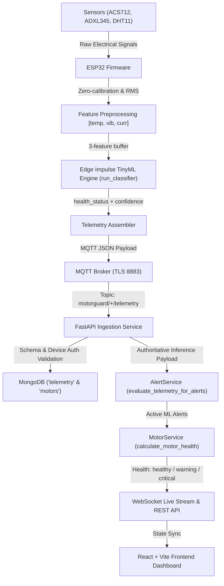

# MotorGuard — Edge ML Primary Motor Health Decision Specification

## 1. System Overview & Rationale

MotorGuard monitors a **775-class 12 V DC brushed permanent-magnet motor** driving industrial actuators and conveyor transmissions. 

In this architecture, **Edge ML inference executed locally on the ESP32 microcontroller is the primary and authoritative decision algorithm for motor-health classification and predictive maintenance alert generation.** Fixed sensor thresholds are strictly decoupled from the motor-health decision algorithm and serve exclusively for deterministic hardware safety protection and sensor diagnostic reporting.

### Why Edge ML is the Primary Motor-Health Classifier
1. **Multivariate Sensor Correlation**: DC motor degradation (commutator brush arcing, bearing raceway spalling, armature inter-turn short circuits) manifests as coupled cross-domain deviations across thermal, dynamic vibration, and current draw rather than isolated scalar threshold exceedances.
2. **Sub-Threshold Anomaly Detection**: Degradation patterns frequently appear within nominal single-variable limits (e.g., slight mechanical drag causing coupled minor current rise and high-frequency vibration before tripping any fixed current limit).
3. **Decentralized Real-Time Execution**: On-device inference guarantees deterministic classification latency (<2 ms) directly at the physical edge without reliance on cloud or network connectivity.

---

## 2. Deployed Model Architecture & Contract

The deployed Edge Impulse TinyML model resides in `Motor_Guard_inferencing/` within the repository.

### Exact Model Specifications
- **Model Framework**: TensorFlow Lite for Microcontrollers (TFLite Micro) compiled C++ static engine.
- **Topology**: Multilayer Perceptron (MLP) Artificial Neural Network.
  - Input Layer: 3 scalar features
  - Hidden Layer 1: Dense (20 units, ReLU activation, INT8 weights and biases)
  - Hidden Layer 2: Dense (10 units, ReLU activation, INT8 weights and biases)
  - Output Layer: Dense (3 units, Softmax activation)
- **Quantization**: Full INT8 post-training quantization.
- **Tensor Arena Size**: 368 bytes static SRAM (`EI_CLASSIFIER_TFLITE_ARENA_SIZE`).
- **Feature Count**: Exactly 3 features.

### Input Features Contract
The feature extraction order and units strictly follow the Edge Impulse trained model axes:
1. **Feature 0**: `temperature_C` (Operating motor casing temperature in degrees Celsius, sampled via DHT11).
2. **Feature 1**: `vibration_g` (Dynamic vibration acceleration in gravity units ($g$), calculated as vector magnitude RMS $\sqrt{a_x^2 + a_y^2 + a_z^2}$ from the ADXL345 accelerometer).
3. **Feature 2**: `current_A` (Armature current draw in Amperes, measured via ACS712-05B Hall-effect sensor with zero-current calibration offset applied).

```c
// Firmware Feature Vector Buffer
float features[3] = {
    temp_c,            // Feature 0: temperature_C
    vib_rms_g,         // Feature 1: vibration_g
    current_a          // Feature 2: current_A
};
```

### Verified Model Output Classes
The model outputs probability confidence scores ($p \in [0.0, 1.0]$) across exactly 3 trained classes:
1. `healthy` ($c_0$): Motor operating within normal electromechanical parameters.
2. `warning` ($c_1$): Incipient abnormal operating pattern detected (early bearing degradation, thermal elevation, or commutator wear).
3. `critical` ($c_2$): Severe operational anomaly or critical fault pattern detected.

---

## 3. End-to-End Processing Pipeline



### 1. ESP32 On-Device Edge ML Inference
- Collects sensor readings and validates ranges.
- Zero-calibrates the ACS712 current sensor.
- Computes vibration vector magnitude RMS over the ADXL345 sampling window.
- Wraps the 3-feature buffer into `signal_t` and calls `run_classifier(&signal, &result, false)`.
- Identifies the highest-confidence classification label and packages it into the `inference` object:
  ```json
  "inference": {
    "status": "PREDICTED",
    "health_status": "healthy",
    "confidence": 0.982,
    "model_version": "1.0.0",
    "anomaly_score": 0.0
  }
  ```

### 2. Telemetry Ingestion & Device Scoping
- Ingested via MQTT on `motorguard/{device_id}/telemetry`.
- Validates device authentication and motor assignment mapping.
- Rejects unauthorized device claims or schema violations.
- Stores full inference telemetry in MongoDB `telemetry` collection with server timestamp.

### 3. Backend Motor Health Calculation (`MotorService`)
- Primary Decision: Checks active `ML_INFERENCE` alerts and the latest authoritative `inference.health_status` from valid fresh telemetry.
- **Threshold Non-Override Guarantee**: Sensor threshold limits do NOT override the Edge ML health classification.
- **Failure State Handling**: Stale telemetry, offline status, or inference errors (`MODEL_ERROR`, `UNAVAILABLE`) return `"unknown"`, never falling back to fixed thresholds or faking a healthy/faulty motor state.

### 4. Alert Generation Workflow (`AlertService`)
- Evaluates `inference.health_status`:
  - `critical`: Triggers `CRITICAL_INFERENCE_FAULT` alert (severity: `CRITICAL`, category: `ML_INFERENCE`).
  - `warning`: Triggers `WARNING_INFERENCE_ANOMALY` alert (severity: `WARNING`, category: `ML_INFERENCE`), deduplicating against concurrent physical safety alerts.
  - `healthy`: Auto-resolves any active `ML_INFERENCE` alerts.
  - `MODEL_ERROR` / `UNAVAILABLE`: Triggers `INFERENCE_DIAGNOSTIC_FAILURE` (category: `SENSOR_DIAGNOSTIC`) while auto-resolving ML motor fault alerts.

### 5. Frontend Presentation
- React Dashboard displays the authoritative ML classification badge (`HEALTHY`, `WARNING`, `CRITICAL`, `UNKNOWN`).
- Visualizes model confidence percentage, model version, and last inference timestamp alongside raw telemetry sensor metrics.
- Enforces zero client-side threshold overrides.

---

## 4. Separation of Motor Health vs. System Health vs. Hardware Safety

| Domain | Scope | Mechanism | Health Classification Impact |
|---|---|---|---|
| **Motor Health Classification** | Incipient physical motor wear & operational condition | Edge Impulse INT8 TinyML Model (`run_classifier`) | **Authoritative Primary Classifier** (`healthy`, `warning`, `critical`) |
| **Sensor Diagnostics** | Disconnected wire, ADC fault, I2C bus hang | `sensor_status` (`DISCONNECTED`, `UNAVAILABLE`) | Motor health reports **`unknown`**; raises `SENSOR_DIAGNOSTIC` alert |
| **Inference Diagnostics** | Model arena overflow, missing features, execution error | `inference.status` (`MODEL_ERROR`, `UNAVAILABLE`) | Motor health reports **`unknown`**; raises `INFERENCE_DIAGNOSTIC_FAILURE` alert |
| **Connectivity & Freshness** | Network drop, ESP32 power failure | `server_received_at` age vs. stale/offline timeouts | Motor health reports **`unknown`**; status switches to `STALE` / `OFFLINE` |
| **Deterministic Hardware Safety** | Gross electrical overcurrent (>4.0A), motor stall lockup | Hardware comparator / `HARD_OVERCURRENT_TRIP` rule | Motor health driven by ML; safety alert triggers independent power cutoff |

---

## 5. Hardware Safety & Emergency Protection Notice

> [!CAUTION]
> **Safety Disclaimer**: The Edge Impulse TinyML model is a predictive maintenance tool designed to forecast electromechanical degradation. It is **not** a SIL-rated or ISO 13849 safety controller. Under dead-short or mechanical rotor-lock conditions, the motor must be protected by an independent, deterministic physical safety mechanism (`HARD_OVERCURRENT_TRIP` and hardware fuse/fuse-holder on the 12V bus). The software classification pipeline must never be relied upon as the sole emergency disconnect.

---

## 6. Hardware Inference vs. Simulator Distinction

To maintain verifiable data provenance and prevent simulated data from masquerading as physical hardware predictions:
- ESP32 hardware telemetry contains `device_id: "esp32-node-001"` and `data_source: "hardware"`.
- Hardware-in-the-Loop (HIL) and synthetic load simulators explicitly emit `data_source: "simulator"`.
- MongoDB schema and database queries preserve the `data_source` field, enabling technicians and auditors to filter telemetry by provenance.
