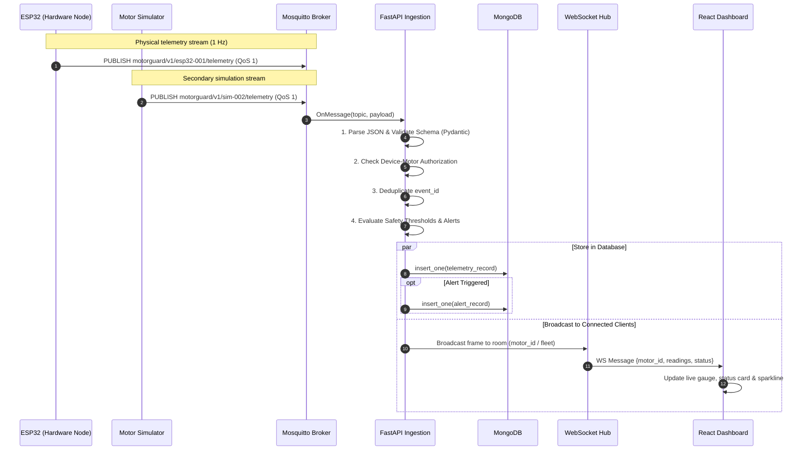

# MotorGuard — System Architecture Specification

## 1. System Overview

**MotorGuard** is an industrial condition-monitoring and predictive maintenance platform designed for multi-motor DC fleets (e.g., RS-775 series motors). The system utilizes a **local-first edge gateway topology**: physical ESP32 microcontrollers acquire vibration, temperature, and electrical current, execute on-device TinyML inference, and publish telemetry over MQTT to a local on-premise gateway.

The local gateway operates autonomously without requiring an active internet connection, ensuring continuous monitoring, logging, and threshold alerting even during wide-area network outages. When wide-area connectivity is available, authorized users access the system remotely through an authenticated gateway or secure VPN.

```
                              [ Physical Motor Fleet ]
       +--------------------+  +--------------------+  +--------------------+
       | Motor 001 + ESP32  |  | Motor 002 + ESP32  |  | Motor N + ESP32    |
       |  DHT11, ADXL345,   |  |  DHT11, ADXL345,   |  |  DHT11, ADXL345,   |
       |  ACS712, TinyML    |  |  ACS712, TinyML    |  |  ACS712, TinyML    |
       +---------+----------+  +---------+----------+  +---------+----------+
                 |                       |                       |
                 +-----------------------+-----------------------+
                                         |
                        Local Wi-Fi / Ethernet LAN (MQTT)
                                         |
                                         v
                      +-------------------------------------+
                      |    Local MotorGuard Edge Gateway    |
                      |   (Always-on PC / Industrial NUC)   |
                      |                                     |
                      |  +-------------------------------+  |
                      |  | Eclipse Mosquitto MQTT Broker |  |
                      |  +---------------+---------------+  |
                      |                  |                  |
                      |                  v                  |
                      |  +-------------------------------+  |
                      |  | FastAPI Ingestion & Rules Engine| |
                      |  +-------+---------------+-------+  |
                      |          |               |          |
                      |          v               v          |
                      |     +---------+     +---------+     |
                      |     | MongoDB |     | Web-    |     |
                      |     | Storage |     | Sockets |     |
                      |     +---------+     +----+----+     |
                      +--------------------------|----------+
                                                 |
                       +-------------------------+-------------------------+
                       |                                                   |
                       v                                                   v
          [ Local Network Users ]                             [ Remote Secure Access ]
          Browser on Factory LAN                              Authenticated Reverse Proxy
          (http://gateway.local:5173)                         / WireGuard VPN
```

---

## 2. Core Architectural Principles

1. **Local-First Reliability**: The gateway continues receiving sensor readings, persisting events to MongoDB, evaluating safety rules, and displaying real-time data to local operators regardless of external internet availability.
2. **Stable Asset Identities**: Every physical motor is assigned an immutable `motor_id` (e.g., `MTR-775-001`). Microcontrollers are assigned a unique hardware `device_id` (e.g., `ESP32-NODE-001`). IP addresses are strictly transport metadata and never used as persistent identities.
3. **One Ingestion Pipeline**: Physical ESP32 devices and the secondary virtual motor simulator publish into the exact same MQTT pipeline using a single versioned telemetry schema (`v1.0.0`). The `source` field explicitly marks events as `"hardware"` or `"simulator"`.
4. **Defense-in-Depth Security**: All RBAC permissions are enforced on the FastAPI server, not in the React client. Database and broker ports are not exposed to the public internet.
5. **Clear Separation of Rule vs. ML Health**: Hard-boundary electrical limits (e.g., overcurrent tripping at 4.0 A) take precedence over machine learning probabilities. ML classifications are presented with model version and confidence metrics.

---

## 3. Component Breakdown & Responsibilities

### 3.1 Edge Microcontroller Layer (ESP32 Firmware)
- **Microcontroller**: ESP32 DevKit V1 (Tensilica Xtensa Dual-Core 240MHz).
- **Sensors**:
  - **ACS712 (20A)**: Hall-effect DC current sensing with conditioned voltage divider (0.100 V/A sensitivity).
  - **ADXL345**: 3-axis digital accelerometer communicating via I2C at 100 Hz; calculates dynamic acceleration RMS in Earth gravity ($g$).
  - **DHT11**: Ambient/chassis temperature sensing via GPIO 4.
- **On-Device Inference**: Edge Impulse C++ library (TensorFlow Lite Micro with EON compiler) classifying operating conditions into `healthy`, `warning`, or `critical`.
- **Communications**: Connects to the local MQTT broker with unique client credentials, publishes telemetry every 1000 ms, maintains periodic heartbeats, and registers a Last Will and Testament (LWT).

### 3.2 Messaging Layer (Eclipse Mosquitto MQTT Broker)
- Serves as the central message router for all telemetry, liveness, and status messages.
- Supports QoS 1 (at-least-once delivery) for telemetry and device status.
- Retains device status topics so newly connected clients immediately know device state.
- Configured for local LAN operation with per-device authentication.

### 3.3 Backend API & Ingestion Engine (Python FastAPI)
- **MQTT Ingestion Worker**: Asynchronous background subscriber processing messages from `motorguard/v1/+/telemetry`.
- **Validation & Sanitization**: Validates payloads against Pydantic models with strict typing, sensor validity status, and timestamp limits.
- **Idempotent Deduplication**: Checks `(device_id, event_id)` against recent database entries to ignore duplicate transmissions.
- **Alert Generation**: Evaluates rules against live readings and persists alerts with severities (`CRITICAL`, `WARNING`, `INFO`).
- **Persistence**: Writes structured documents to MongoDB.
- **Real-Time Distribution**: Pushes fresh readings and device state changes to connected dashboard clients via WebSockets (`/ws/telemetry`).
- **REST APIs**: Provides endpoints for asset management, historical trend queries, maintenance tracking, user authentication, and system health checks.

### 3.4 Data Storage Layer (Local MongoDB)
- Document-oriented store on the gateway host running with persistent volumes.
- Optimized with compound indexes on `(motor_id, timestamp)` and `(device_id, event_id)`.
- Stores 8 core collections: `users`, `sites`, `motors`, `devices`, `telemetry`, `alerts`, `maintenance_records`, and `audit_events`.

### 3.5 Frontend Client (React + Vite + TypeScript)
- Industrial dashboard single-page application (SPA).
- Real-time live status indicators with automatic fallback to polling if WebSocket disconnects.
- Detailed motor profiles, historical time-series graphs, interactive alert acknowledgement consoles, and maintenance logging.
- Role-based UI view adaptation (while all business rules remain server-enforced).

### 3.6 Virtual Motor Simulator (Python Diagnostic Tool)
- Standalone Python utility emulating one or multiple DC motors.
- Injects degradation patterns (gradual temperature rise, bearing wear vibration, stall current) and network disruptions.
- Marks all payloads with `source: "simulator"`.

---

## 4. End-to-End Data Flow



---

## 5. Gateway Operational Failure Modes

| Failure Scenario | Local Gateway Impact | User Experience (Local) | User Experience (Remote) |
| :--- | :--- | :--- | :--- |
| **Internet Outage** | Gateway continues 100% operational | No disruption; full dashboard & alerts work | Remote connection temporarily unavailable |
| **Local Wi-Fi Drop** | ESP32s buffer readings (if enabled) | Dashboard marks devices STALE/OFFLINE | Dashboard marks devices STALE/OFFLINE |
| **Broker Restart** | Ingestion reconnects with backoff | UI shows temporary reconnect banner | UI shows temporary reconnect banner |
| **Sensor Disconnected** | Hardware reports `status: DISCONNECTED` | UI displays "DISCONNECTED", no fake 0.0 | UI displays "DISCONNECTED", no fake 0.0 |
| **Gateway Power Loss** | System halts until power restored | Offline | Offline |
